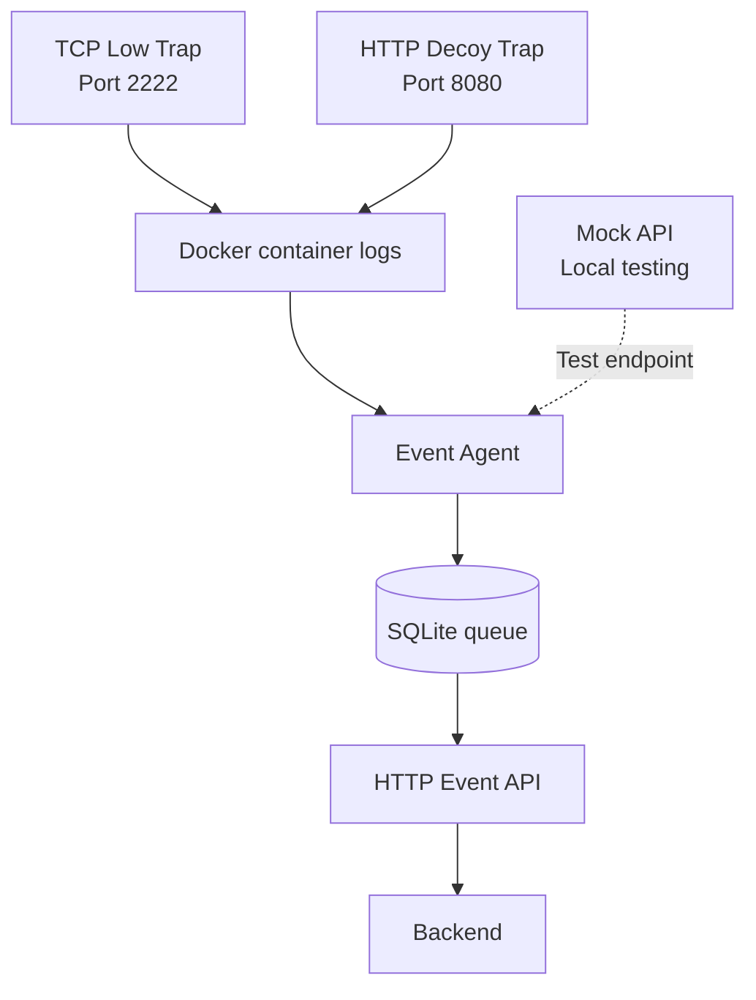

# HoneyForge

**A modular honeypot platform for capturing, structuring, and forwarding suspicious network activity.**

HoneyForge is a security research project that combines lightweight network decoys, configurable trap profiles, structured event logging, and an event-forwarding agent. It also includes a C++ backend codebase for managing honeypot-related entities.

The goal is to make suspicious interactions observable in a controlled environment and provide a foundation for centralized event collection and analysis.

> **Project status:** The TCP and HTTP traps, profile validator, and Python Event Agent are implemented. The Event Agent has been tested against a local mock API, including retry behavior after simulated HTTP 503 responses. Integration with the production backend is not yet confirmed.

---

## Contents

- [Overview](#overview)
- [Architecture](#architecture)
- [Features](#features)
- [Repository structure](#repository-structure)
- [Requirements](#requirements)
- [Quick start](#quick-start)
- [Running the traps](#running-the-traps)
- [Testing the Event Agent](#testing-the-event-agent)
- [Event format](#event-format)
- [Security considerations](#security-considerations)
- [C++ backend dependencies](#c-backend-dependencies)
- [Troubleshooting](#troubleshooting)
- [Current limitations](#current-limitations)
- [Roadmap](#roadmap)

## Overview

A honeypot is a decoy service designed to attract and observe interactions that may be associated with scanning, automated probing, or other suspicious activity.

HoneyForge currently includes two network-facing decoys:

| Component | Default port | Purpose |
|---|---:|---|
| TCP Low | `2222/tcp` | Accepts TCP connections and presents an SSH-like banner |
| HTTP Decoy | `8080/tcp` | Responds to HTTP requests and records request metadata |
| Event Agent | Local process | Collects container logs, persists events, and forwards them to an API |
| Mock API | `127.0.0.1:8099` | Provides a local endpoint for testing event delivery and retry behavior |
| Profile Validator | CLI | Checks trap profile configuration files |

The traps are intended for controlled testing and defensive security research. They are not full implementations of SSH or Apache HTTP Server.

## Architecture



### Event processing flow

1. A client connects to a trap or sends an HTTP request.
2. The trap records structured event data in its container logs.
3. The Event Agent polls Docker logs and extracts valid events.
4. Events are normalized and stored in a local SQLite queue with a generated event ID.
5. The agent sends queued events to the configured API.
6. Temporary delivery failures trigger retries with exponential backoff.
7. Invalid or unsupported events can be moved to a dead-letter log for inspection.

The local mock API is intended for development and testing. It is not the production backend.

## Features

### TCP Low

- Listens on TCP port `2222` by default.
- Sends an SSH-like identification banner.
- Records connection lifecycle events, including connection open, received byte count, timeout, error, and connection close where applicable.
- Records metadata rather than the full contents of received data.

### HTTP Decoy

- Listens on port `8080` by default.
- Responds to HTTP requests.
- Records request metadata such as method, path, source IP, destination port, status code, and body size.
- Includes indicators for selected suspicious request patterns.
- Does not intentionally store complete HTTP request bodies or header values in its event payload.

### Event Agent

- Collects events from Docker container logs.
- Uses SQLite to persist collection state and outgoing events.
- Generates an event ID before delivery so retries can reuse the same ID.
- Retries temporary failures, including HTTP 429 and server errors.
- Supports a dead-letter JSON Lines file for events that cannot be delivered permanently.
- Can be tested against the local mock API without a production backend.

### Container hardening

The trap Compose configurations include security-oriented settings such as a read-only root filesystem, dropped Linux capabilities, `no-new-privileges`, memory limits, and PID limits. Review the actual Compose files before deploying because effective security also depends on the host, Docker configuration, and network exposure.

## Repository structure

```text
HoneyForge/
├── src/                         # C++ backend source code
│   ├── controllers/              # CRUD and database controllers
│   └── models/                   # Backend data models
├── traps/
│   ├── tcp-low/
│   │   ├── trap.py               # TCP decoy
│   │   ├── tcp-basic.yaml        # TCP trap configuration
│   │   ├── Dockerfile
│   │   └── compose.yaml
│   └── http-decoy/
│       ├── trap.py               # HTTP decoy
│       ├── Dockerfile
│       └── compose.yaml
├── profiles/
│   ├── tcp-basic.yaml            # TCP profile
│   └── http-basic.yaml           # HTTP profile
├── profile-loader/
│   └── validate_profile.py      # Profile validation CLI
├── event-agent/
│   ├── agent.py                  # Log collection and event delivery
│   └── mock_api.py               # Local API test server
├── CMakeLists.txt                # C++ build configuration
├── README.md
└── .gitignore
```

Runtime data, including the SQLite database and dead-letter files, is local state and should not be committed to the repository.

## Requirements

For the trap and Event Agent components:

- Linux environment such as Debian
- Docker Engine and Docker Compose plugin
- Python 3.11 or newer recommended
- Python virtual environment support
- `curl` for HTTP testing
- `nc` (netcat) for TCP testing

For profile validation, install PyYAML in a virtual environment if it is not already available:

```bash
cd /path/to/HoneyForge
python3 -m venv .venv
. .venv/bin/activate
python -m pip install PyYAML
```

The Event Agent and mock API use Python standard-library modules for their core functionality. Docker must be installed and accessible to the account running the agent.

## Quick start

### 1. Get the repository

```bash
git clone https://github.com/TundraZD/HoneyForge.git
cd HoneyForge
```

To work on the Event Agent changes before they are merged into `main`, check out the feature branch:

```bash
git fetch origin
git switch --track origin/feature/honeypot-event-agent
```

If the branch has already been merged or removed, use the current default branch instead.

### 2. Validate the profiles

Activate your virtual environment and install PyYAML as described above. Then run:

```bash
python profile-loader/validate_profile.py profiles/tcp-basic.yaml
python profile-loader/validate_profile.py profiles/http-basic.yaml
```

Check the validator's help output if your local version expects a different argument format:

```bash
python profile-loader/validate_profile.py --help
```

### 3. Start the traps

Build and start the TCP trap:

```bash
docker compose -f traps/tcp-low/compose.yaml up --build -d
```

Build and start the HTTP trap:

```bash
docker compose -f traps/http-decoy/compose.yaml up --build -d
```

Check container status and published ports:

```bash
docker ps --format 'table {{.Names}}\t{{.Status}}\t{{.Ports}}'
```

### 4. Test the HTTP decoy

```bash
curl -i http://127.0.0.1:8080/
```

A successful request should return an HTTP response. Inspect the container logs:

```bash
docker logs --since 2m --timestamps honeyforge-http-001
```

The Compose configuration determines the actual container name. If the name differs, find it with `docker ps`.

### 5. Test the TCP decoy

```bash
printf 'test\n' | nc -w 2 127.0.0.1 2222
```

The TCP trap should return its SSH-like banner. Inspect its logs:

```bash
docker logs --since 2m --timestamps trap-001
```

If the container has a different name, use the name shown by `docker ps`.

## Testing the Event Agent

The mock API allows the delivery pipeline to be tested without connecting to a production service.

### 1. Start the mock API

From the repository root, activate the Python environment if you use one. Start the mock server with two simulated initial failures:

```bash
python event-agent/mock_api.py --fail-first 2 \
  > /tmp/hf-mock.log 2>&1 &
echo $! > /tmp/hf-mock.pid
```

The mock server is expected to listen on `127.0.0.1:8099` and use the test key `test-key` in the current development configuration. Check the script's help or source if its arguments differ.

### 2. Start the Event Agent

```bash
HONEYFORGE_API_URL=http://127.0.0.1:8099/api/v1/events \
HONEYFORGE_API_KEY=test-key \
python event-agent/agent.py \
  > /tmp/hf-agent.log 2>&1 &
echo $! > /tmp/hf-agent.pid
```

Use the environment variable names supported by the version of the agent you are running. The example key is for local testing only.

### 3. Generate events

In another terminal, send a request to the HTTP trap:

```bash
curl -i http://127.0.0.1:8080/
```

You can also connect to the TCP trap:

```bash
printf 'test\n' | nc -w 2 127.0.0.1 2222
```

### 4. Inspect agent and mock logs

```bash
tail -n 30 /tmp/hf-agent.log
tail -n 30 /tmp/hf-mock.log
```

With `--fail-first 2`, the mock API simulates two HTTP 503 responses before accepting a request. The agent should retry and eventually deliver the event when the API becomes available.

### 5. Inspect the SQLite queue

```bash
python - <<'PY'
import sqlite3

db = sqlite3.connect("data/event-agent.sqlite3")

print("Queue statistics:")
for row in db.execute(
    "SELECT status, COUNT(*) FROM events GROUP BY status"
):
    print(row)

print("\nRecent events:")
for row in db.execute("""
    SELECT event_id, status, attempts, last_error
    FROM events
    ORDER BY created_at DESC
    LIMIT 10
"""):
    print(row)

db.close()
PY
```

Typical statuses include queued, sent, and dead-lettered states, depending on the agent version. Use the actual values returned by the database rather than assuming a particular state is present.

### 6. Stop the test processes

```bash
[ -f /tmp/hf-agent.pid ] && kill "$(cat /tmp/hf-agent.pid)" 2>/dev/null || true
[ -f /tmp/hf-mock.pid ] && kill "$(cat /tmp/hf-mock.pid)" 2>/dev/null || true
```

Stop the traps when you no longer need them:

```bash
docker compose -f traps/http-decoy/compose.yaml down
docker compose -f traps/tcp-low/compose.yaml down
```

## Event format

Trap logs use structured JSON. A representative HTTP event looks like this:

```json
{
  "timestamp": "2026-10-15T16:20:27.003113Z",
  "trap_ref": "http-001",
  "profile": "http-basic",
  "event_type": "http_request",
  "source_ip": "172.19.0.1",
  "dest_port": 8080,
  "protocol": "tcp",
  "payload": {
    "method": "GET",
    "path": "/",
    "body_bytes": 0,
    "suspicious": false,
    "indicators": [],
    "status_code": 200,
    "body_truncated": false
  }
}
```

The Event Agent wraps collected events in the backend event envelope. The expected API contract is:

```http
POST /api/v1/events
Content-Type: application/json
X-API-Key: <API_KEY>
```

Example envelope:

```json
{
  "event_id": "UUID",
  "trap_ref": "http-001",
  "source_ip": "203.0.113.45",
  "timestamp": "2026-10-15T09:12:03Z",
  "event_type": "http_request",
  "dest_port": 8080,
  "protocol": "tcp",
  "payload": {}
}
```

Important fields:

| Field | Description |
|---|---|
| `event_id` | Unique event identifier reused across retries |
| `trap_ref` | String identifier that associates the event with a configured trap |
| `source_ip` | Address of the client that interacted with the trap |
| `timestamp` | Event timestamp in UTC |
| `event_type` | Type of interaction recorded |
| `dest_port` | Destination port observed by the trap |
| `protocol` | Transport or application protocol label |
| `payload` | Event-specific JSON data |

The production backend is expected to accept `201 Created` for a new event and `200 OK` for a duplicate. Temporary errors such as `429` and `5xx` should be retried. Invalid events and unknown trap references may be rejected permanently. Authentication failures (`401` or `403`) require operator attention.

Confirm the backend implementation and its current contract before connecting a real deployment.

## Security considerations

- **Use an isolated environment.** Deploy decoys on a dedicated test network or a controlled host.
- **Limit exposure.** Do not publish trap ports to untrusted networks unless that is an intentional, approved deployment decision.
- **Protect API credentials.** Do not commit real API keys, passwords, tokens, `.env` files, or local credentials.
- **Use HTTPS for remote APIs.** Plain HTTP in the mock setup is intended for localhost testing only.
- **Minimize collected data.** Review event fields and retention policies before collecting traffic from real networks.
- **Keep runtime data out of Git.** SQLite databases, WAL/SHM files, virtual environments, caches, and logs are local artifacts.
- **Review container settings.** Read-only filesystems and dropped capabilities help reduce risk but do not make a container or host invulnerable.
- **Monitor resource use.** Set and review container limits, log retention, disk usage, and queue growth.
- **Handle credentials carefully.** Restrict access to local configuration and agent logs.

HoneyForge is a defensive research tool. Operate it only on systems and networks you own or are authorized to monitor.

## C++ backend dependencies

The repository also contains a C++ backend codebase using CMake and PostgreSQL client libraries.

The existing Windows setup notes use `vcpkg` to install `libpqxx`. A typical setup in a Windows developer shell is:

```powershell
git clone https://github.com/microsoft/vcpkg.git
cd vcpkg
.\bootstrap-vcpkg.bat
.\vcpkg install libpqxx
.\vcpkg integrate install
```

Open the solution or CMake project using the development environment configured by the project maintainers. Verify the required compiler, CMake version, PostgreSQL configuration, and library triplet against the current `CMakeLists.txt` and team setup before building.

The Python traps and Event Agent can be developed independently of the C++ backend. A complete production integration between the Event Agent API contract and the C++ backend is not yet confirmed.

## Troubleshooting

### The HTTP page does not open

Check whether the container is running and port `8080` is published:

```bash
docker ps
docker logs --tail 100 honeyforge-http-001
curl -v http://127.0.0.1:8080/
```

Use the actual container name reported by Docker if it differs.

### The TCP trap does not respond

```bash
docker ps
docker logs --tail 100 trap-001
nc -vz 127.0.0.1 2222
```

Check port publishing, container status, and host firewall rules.

### The agent is not collecting events

```bash
tail -n 100 /tmp/hf-agent.log
docker logs --since 5m trap-001
docker logs --since 5m honeyforge-http-001
```

Confirm that the agent can access Docker and that the trap emits valid JSON lines containing the fields expected by the collector.

### The agent cannot deliver events

```bash
tail -n 100 /tmp/hf-agent.log
tail -n 100 /tmp/hf-mock.log
```

Verify the API URL, API key, network connectivity, and accepted `trap_ref` values. For the mock API, use only the development credentials documented in the test setup.

### Profile validation fails

```bash
python profile-loader/validate_profile.py --help
```

Check the YAML syntax, required fields, and validator usage. Install PyYAML in the active Python environment if the module is missing.

## Current limitations

- The TCP decoy presents an SSH-like banner; it is not a full SSH server and does not implement SSH authentication.
- HTTP inspection is limited to the fields and indicators implemented by the current trap.
- The mock API is a development aid, not a production service.
- Successful end-to-end delivery has been verified against the mock API; production backend integration remains to be validated.
- The C++ backend source exists in the repository, but a complete HTTP ingestion endpoint and production deployment workflow are not documented as working.
- Operational dashboards, production alerting, and comprehensive attack detection are not included in the currently verified feature set.

## Roadmap

Potential next steps:

- [ ] Implement and verify the production event ingestion endpoint.
- [ ] Add integration tests for TCP and HTTP event delivery.
- [ ] Add automated tests for retry, dead-letter, and authentication-failure paths.
- [ ] Document backend configuration and database setup.
- [ ] Add structured health checks and operational metrics.
- [ ] Define event retention, rotation, and privacy policies.
- [ ] Add CI checks for Python syntax, profile validation, and container builds.

---

## Contributing

1. Create a feature branch.
2. Keep changes focused and document configuration changes.
3. Run the relevant validation and smoke tests.
4. Do not commit secrets, local databases, virtual environments, or generated files.
5. Open a Pull Request for review before merging into `main`.

## License

No license has been specified in this README. Check the repository's licensing requirements with the maintainers before redistributing the project.
