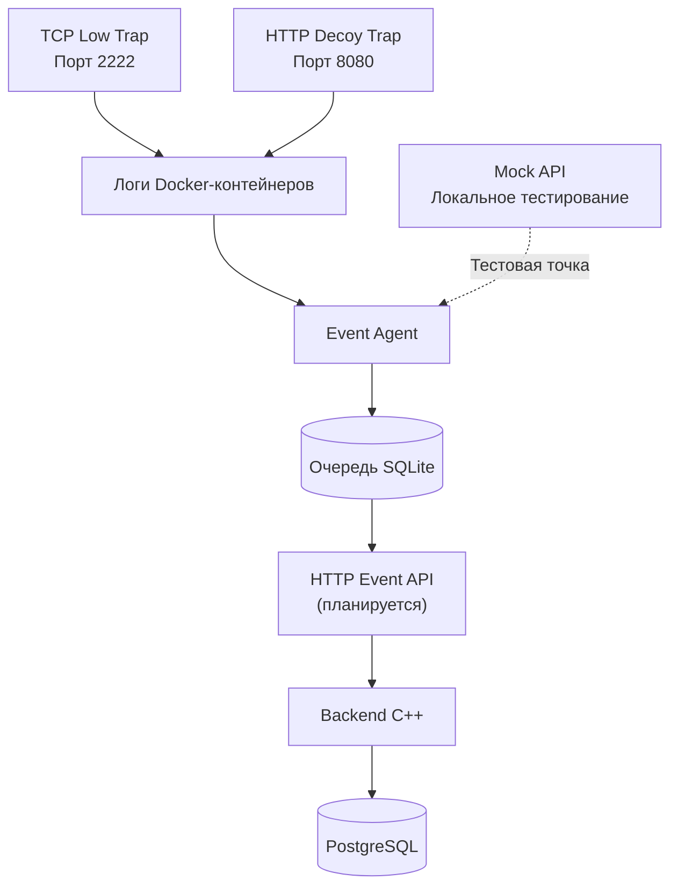
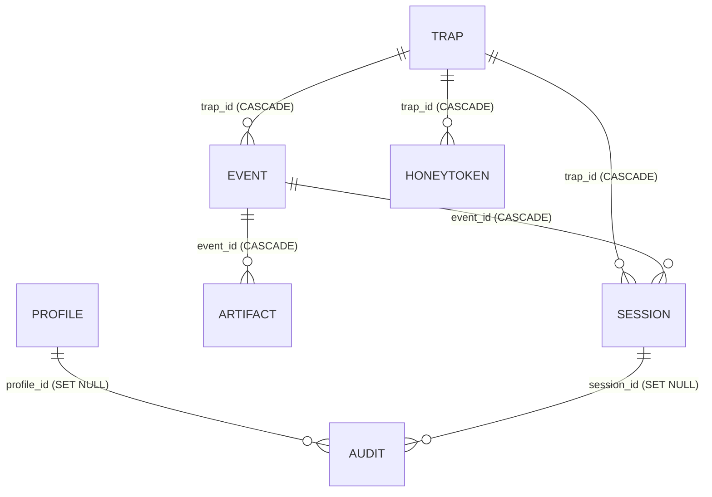

# 🍯 HoneyForge

**Модульная платформа honeypot для перехвата, структурирования и пересылки подозрительной сетевой активности.**

HoneyForge — исследовательский проект в области безопасности. Он объединяет лёгкие сетевые приманки, настраиваемые профили ловушек, структурированное логирование событий и агент пересылки событий. В репозитории также есть backend-код на C++ для управления сущностями honeypot.

Цель проекта — сделать подозрительные взаимодействия наблюдаемыми в контролируемой среде и заложить основу для централизованного сбора и анализа событий.

> 📌 **Статус проекта:** реализованы TCP- и HTTP-ловушки, валидатор профилей и Event Agent на Python. Event Agent проверен на локальном mock API, включая повторные попытки после имитированных ответов HTTP 503. Backend на C++ создаёт схему в PostgreSQL и даёт консольное меню CRUD для всех таблиц, но HTTP API для приёма событий в нём пока нет, поэтому интеграция агента с боевым backend не подтверждена.

---

## 📑 Содержание

- [📖 Обзор](#-обзор)
- [🧩 Архитектура](#-архитектура)
- [✨ Возможности](#-возможности)
- [📁 Структура репозитория](#-структура-репозитория)
- [📋 Требования](#-требования)
- [🚀 Быстрый старт](#-быстрый-старт)
- [🧪 Тестирование Event Agent](#-тестирование-event-agent)
- [📨 Формат событий](#-формат-событий)
- [🔒 Безопасность](#-безопасность)
- [💾 Backend: C++ и PostgreSQL](#-backend-c-и-postgresql)
- [🩺 Устранение неполадок](#-устранение-неполадок)
- [🚧 Текущие ограничения](#-текущие-ограничения)
- [🎯 Дорожная карта](#-дорожная-карта)
- [🤝 Участие в проекте](#-участие-в-проекте)
- [📄 Лицензия](#-лицензия)

## 📖 Обзор

Honeypot — это сервис-приманка, который привлекает и позволяет наблюдать взаимодействия, связанные со сканированием, автоматическим зондированием и другой подозрительной активностью.

Сейчас в HoneyForge входят две сетевые приманки и вспомогательные компоненты:

| Компонент | Порт по умолчанию | Назначение |
|---|---:|---|
| 🔌 TCP Low | `2222/tcp` | Принимает TCP-соединения и показывает SSH-подобный баннер |
| 🌐 HTTP Decoy | `8080/tcp` | Отвечает на HTTP-запросы и записывает метаданные запросов |
| 🤖 Event Agent | локальный процесс | Собирает логи контейнеров, сохраняет события и пересылает их в API |
| 🧪 Mock API | `127.0.0.1:8099` | Локальная точка для проверки доставки событий и повторных попыток |
| ✅ Profile Validator | CLI | Проверяет конфигурационные файлы профилей ловушек |
| 💾 Backend (C++) | консольное приложение | Создаёт схему PostgreSQL и управляет данными через меню CRUD (HTTP API пока нет) |

Ловушки предназначены для контролируемого тестирования и оборонительных исследований в области безопасности. Это не полноценные реализации SSH или веб-сервера Apache.

## 🧩 Архитектура



### 🔄 Обработка событий

1. Клиент подключается к ловушке или отправляет HTTP-запрос.
2. Ловушка записывает структурированные данные события в логи своего контейнера.
3. Event Agent читает логи Docker и выделяет из них корректные события.
4. События нормализуются и сохраняются в локальную очередь SQLite с сгенерированным идентификатором события.
5. Агент отправляет события из очереди в настроенный API.
6. При временных сбоях доставки выполняются повторные попытки с экспоненциальной задержкой.
7. Некорректные или неподдерживаемые события можно перенести в dead-letter-журнал для разбора.

Локальный mock API нужен для разработки и тестирования. Это не боевой backend.

## ✨ Возможности

### 🔌 TCP Low

- По умолчанию слушает TCP-порт `2222`.
- Отправляет SSH-подобный идентификационный баннер.
- Записывает события жизненного цикла соединения: открытие, число принятых байт, таймаут, ошибка и закрытие (где применимо).
- Сохраняет метаданные, а не полное содержимое полученных данных.

### 🌐 HTTP Decoy

- По умолчанию слушает порт `8080`.
- Отвечает на HTTP-запросы.
- Записывает метаданные запроса: метод, путь, IP-адрес источника, порт назначения, код ответа и размер тела.
- Содержит индикаторы для отдельных подозрительных шаблонов запросов.
- Намеренно не сохраняет в событии тело запроса целиком и значения заголовков.

### 🤖 Event Agent

- Собирает события из логов Docker-контейнеров.
- Использует SQLite для хранения состояния сбора и исходящих событий.
- Генерирует идентификатор события до отправки, поэтому при повторах используется тот же ID.
- Повторяет отправку при временных сбоях, включая HTTP 429 и ошибки сервера.
- Ведёт dead-letter-файл в формате JSON Lines для событий, которые невозможно доставить.
- Можно проверять на локальном mock API без боевого backend.

### 🛡️ Укрепление контейнеров

В Compose-конфигурациях ловушек используются настройки безопасности: корневая файловая система только для чтения, сброс Linux capabilities, `no-new-privileges`, ограничения памяти и числа процессов. Перед развёртыванием проверьте реальные Compose-файлы: итоговая защищённость зависит также от хоста, настроек Docker и сетевой доступности.

## 📁 Структура репозитория

```text
HoneyForge/
├── src/                         # Исходный код C++ backend
│   ├── main.cpp                  # Подключение к БД, создание таблиц, запуск меню
│   ├── controllers/              # CRUD-функции по таблицам и консольное меню
│   │   ├── *_crud.cpp / .hpp     # create / read / update / delete для каждой таблицы
│   │   └── bd_control.cpp        # Интерактивное меню BD Control
│   └── models/                   # Классы с SQL создания таблиц (createTable)
├── traps/
│   ├── tcp-low/
│   │   ├── trap.py               # TCP-приманка
│   │   ├── tcp-basic.yaml        # Конфигурация TCP-ловушки
│   │   ├── Dockerfile
│   │   └── compose.yaml
│   └── http-decoy/
│       ├── trap.py               # HTTP-приманка
│       ├── Dockerfile
│       └── compose.yaml
├── profiles/
│   ├── tcp-basic.yaml            # TCP-профиль
│   └── http-basic.yaml           # HTTP-профиль
├── profile-loader/
│   └── validate_profile.py      # CLI проверки профилей
├── event-agent/
│   ├── agent.py                  # Сбор логов и доставка событий
│   └── mock_api.py               # Локальный тестовый API-сервер
├── CMakeLists.txt                # Конфигурация сборки C++
├── README.md
└── .gitignore
```

Данные времени выполнения, включая базу SQLite и dead-letter-файлы, — это локальное состояние. Их не нужно коммитить в репозиторий.

## 📋 Требования

Для ловушек и Event Agent:

- Linux-окружение, например Debian
- Docker Engine и плагин Docker Compose
- Python 3.11 или новее (рекомендуется)
- Поддержка виртуальных окружений Python
- `curl` для HTTP-тестов
- `nc` (netcat) для TCP-тестов

Для проверки профилей установите PyYAML в виртуальное окружение, если он ещё не доступен:

```bash
cd /path/to/HoneyForge
python3 -m venv .venv
. .venv/bin/activate
python -m pip install PyYAML
```

Основная функциональность Event Agent и mock API использует только стандартную библиотеку Python. Docker должен быть установлен и доступен пользователю, от имени которого запускается агент.

## 🚀 Быстрый старт

### 1️⃣ Получите репозиторий

```bash
git clone https://github.com/TundraZD/HoneyForge.git
cd HoneyForge
```

Чтобы поработать с изменениями Event Agent до их слияния в `main`, переключитесь на ветку с функциональностью:

```bash
git fetch origin
git switch --track origin/feature/honeypot-event-agent
```

Если ветка уже влита или удалена, используйте текущую ветку по умолчанию.

### 2️⃣ Проверьте профили

Активируйте виртуальное окружение и установите PyYAML, как описано выше. Затем выполните:

```bash
python profile-loader/validate_profile.py profiles/tcp-basic.yaml
python profile-loader/validate_profile.py profiles/http-basic.yaml
```

Если ваша версия валидатора ожидает другой формат аргументов, посмотрите справку:

```bash
python profile-loader/validate_profile.py --help
```

### 3️⃣ Запустите ловушки

Соберите и запустите TCP-ловушку:

```bash
docker compose -f traps/tcp-low/compose.yaml up --build -d
```

Соберите и запустите HTTP-ловушку:

```bash
docker compose -f traps/http-decoy/compose.yaml up --build -d
```

Проверьте состояние контейнеров и опубликованные порты:

```bash
docker ps --format 'table {{.Names}}\t{{.Status}}\t{{.Ports}}'
```

### 4️⃣ Проверьте HTTP-приманку

```bash
curl -i http://127.0.0.1:8080/
```

Успешный запрос должен вернуть HTTP-ответ. Посмотрите логи контейнера:

```bash
docker logs --since 2m --timestamps honeyforge-http-001
```

Фактическое имя контейнера задаётся в Compose-конфигурации. Если оно отличается, найдите его командой `docker ps`.

### 5️⃣ Проверьте TCP-приманку

```bash
printf 'test\n' | nc -w 2 127.0.0.1 2222
```

TCP-ловушка должна вернуть SSH-подобный баннер. Посмотрите её логи:

```bash
docker logs --since 2m --timestamps trap-001
```

Если у контейнера другое имя, используйте имя из вывода `docker ps`.

## 🧪 Тестирование Event Agent

Mock API позволяет проверить конвейер доставки без подключения к боевому сервису.

### 1️⃣ Запустите mock API

Из корня репозитория активируйте окружение Python, если вы его используете. Запустите mock-сервер с двумя имитированными начальными сбоями:

```bash
python event-agent/mock_api.py --fail-first 2 \
  > /tmp/hf-mock.log 2>&1 &
echo $! > /tmp/hf-mock.pid
```

Mock-сервер должен слушать `127.0.0.1:8099` и в текущей конфигурации разработки использует тестовый ключ `test-key`. Если аргументы отличаются, посмотрите справку или исходный код скрипта.

### 2️⃣ Запустите Event Agent

```bash
HONEYFORGE_API_URL=http://127.0.0.1:8099/api/v1/events \
HONEYFORGE_API_KEY=test-key \
python event-agent/agent.py \
  > /tmp/hf-agent.log 2>&1 &
echo $! > /tmp/hf-agent.pid
```

Используйте имена переменных окружения, которые поддерживает запускаемая версия агента. Ключ из примера предназначен только для локального тестирования.

### 3️⃣ Сгенерируйте события

В другом терминале отправьте запрос к HTTP-ловушке:

```bash
curl -i http://127.0.0.1:8080/
```

Можно также подключиться к TCP-ловушке:

```bash
printf 'test\n' | nc -w 2 127.0.0.1 2222
```

### 4️⃣ Посмотрите логи агента и mock API

```bash
tail -n 30 /tmp/hf-agent.log
tail -n 30 /tmp/hf-mock.log
```

С параметром `--fail-first 2` mock API дважды имитирует ответ HTTP 503, прежде чем принять запрос. Агент должен повторить отправку и в итоге доставить событие, когда API станет доступен.

### 5️⃣ Посмотрите очередь SQLite

```bash
python - <<'PY'
import sqlite3

db = sqlite3.connect("data/event-agent.sqlite3")

print("Queue statistics:")
for row in db.execute(
    "SELECT status, COUNT(*) FROM events GROUP BY status"
):
    print(row)

print("\nRecent events:")
for row in db.execute("""
    SELECT event_id, status, attempts, last_error
    FROM events
    ORDER BY created_at DESC
    LIMIT 10
"""):
    print(row)

db.close()
PY
```

Типичные статусы — «в очереди», «отправлено» и «в dead-letter», в зависимости от версии агента. Ориентируйтесь на фактические значения из базы данных и не рассчитывайте на наличие какого-то конкретного статуса.

### 6️⃣ Остановите тестовые процессы

```bash
[ -f /tmp/hf-agent.pid ] && kill "$(cat /tmp/hf-agent.pid)" 2>/dev/null || true
[ -f /tmp/hf-mock.pid ] && kill "$(cat /tmp/hf-mock.pid)" 2>/dev/null || true
```

Когда ловушки больше не нужны, остановите их:

```bash
docker compose -f traps/http-decoy/compose.yaml down
docker compose -f traps/tcp-low/compose.yaml down
```

## 📨 Формат событий

Логи ловушек используют структурированный JSON. Пример типичного HTTP-события:

```json
{
  "timestamp": "2026-10-15T16:20:27.003113Z",
  "trap_ref": "http-001",
  "profile": "http-basic",
  "event_type": "http_request",
  "source_ip": "172.19.0.1",
  "dest_port": 8080,
  "protocol": "tcp",
  "payload": {
    "method": "GET",
    "path": "/",
    "body_bytes": 0,
    "suspicious": false,
    "indicators": [],
    "status_code": 200,
    "body_truncated": false
  }
}
```

Event Agent оборачивает собранные события в конверт для backend. Ожидаемый контракт API:

```http
POST /api/v1/events
Content-Type: application/json
X-API-Key: <API_KEY>
```

Пример конверта:

```json
{
  "event_id": "UUID",
  "trap_ref": "http-001",
  "source_ip": "203.0.113.45",
  "timestamp": "2026-10-15T09:12:03Z",
  "event_type": "http_request",
  "dest_port": 8080,
  "protocol": "tcp",
  "payload": {}
}
```

Основные поля:

| Поле | Описание |
|---|---|
| `event_id` | Уникальный идентификатор события, одинаковый при всех повторах |
| `trap_ref` | Строковый идентификатор, связывающий событие с настроенной ловушкой |
| `source_ip` | Адрес клиента, взаимодействовавшего с ловушкой |
| `timestamp` | Время события в UTC |
| `event_type` | Тип зафиксированного взаимодействия |
| `dest_port` | Порт назначения, который видит ловушка |
| `protocol` | Метка транспортного или прикладного протокола |
| `payload` | JSON-данные, специфичные для конкретного события |

Ожидается, что боевой backend отвечает `201 Created` на новое событие и `200 OK` на дубликат. Временные ошибки (`429`, `5xx`) нужно повторять. Некорректные события и неизвестные ссылки на ловушки могут отклоняться окончательно. Ошибки аутентификации (`401` или `403`) требуют внимания оператора.

Перед подключением реального развёртывания уточните реализацию backend и актуальный контракт.

## 🔒 Безопасность

- 🧱 **Используйте изолированное окружение.** Размещайте приманки в отдельной тестовой сети или на контролируемом хосте.
- 🚪 **Ограничивайте доступ.** Не публикуйте порты ловушек в недоверенные сети, если это не осознанное и согласованное решение о развёртывании.
- 🔑 **Защищайте учётные данные API.** Не коммитьте реальные API-ключи, пароли, токены, файлы `.env` и локальные учётные данные.
- 🔐 **Используйте HTTPS для удалённых API.** Обычный HTTP в конфигурации с mock API предназначен только для localhost.
- 🧹 **Собирайте минимум данных.** Перед сбором трафика из реальных сетей проверьте поля событий и политики хранения.
- 🗂️ **Не храните данные выполнения в Git.** Базы SQLite, файлы WAL/SHM, виртуальные окружения, кэши и логи — локальные артефакты.
- 📦 **Проверяйте настройки контейнеров.** Файловая система только для чтения и сброшенные capabilities снижают риск, но не делают контейнер или хост неуязвимым.
- 📊 **Следите за ресурсами.** Задавайте и проверяйте лимиты контейнеров, срок хранения логов, использование диска и рост очереди.
- 👀 **Аккуратно обращайтесь с учётными данными.** Ограничьте доступ к локальной конфигурации и логам агента.
- 🗝️ **Пароль БД в коде backend.** Строка подключения с паролем зашита в `src/main.cpp`. Вынесите её в переменные окружения до публикации и развёртывания.
- 👤 **Пароли профилей.** Меню BD Control сохраняет в `Profile.password_hash` то значение, которое ввёл оператор, и хеширования не выполняет. Перед использованием храните там только хеш, полученный надёжным алгоритмом.

HoneyForge — оборонительный исследовательский инструмент. Используйте его только в системах и сетях, которыми вы владеете или мониторинг которых вам разрешён.

## 💾 Backend: C++ и PostgreSQL

Backend — консольное приложение на C++17. Оно подключается к PostgreSQL через C-библиотеку `libpq`, при запуске создаёт недостающие таблицы и открывает интерактивное меню **BD Control** для ручного управления данными. Задача backend — хранить ловушки, события, сессии, приманки-токены, артефакты и аудит.

> ⚠️ HTTP-сервера в backend пока нет: он не принимает события от Event Agent. Ожидаемый контракт API описан в разделе «Формат событий», реализация запланирована.

### 🧱 Как устроен код

| Слой | Где лежит | Что делает |
|---|---|---|
| Точка входа | `src/main.cpp` | Подключается к PostgreSQL, вызывает `createTable` для каждой модели, печатает итог инициализации, запускает меню |
| Модели | `src/models/*.hpp` | Класс на таблицу со статическим методом `createTable(PGconn*)`. Возвращает `1` (создана), `0` (уже была), `-1` (ошибка) |
| Контроллеры | `src/controllers/*_crud.cpp` | Функции `create…`, `read…ById`, `readAll…`, `update…`, `delete…` с параметризованными запросами (`PQexecParams`), то есть с защитой от SQL-инъекций |
| Меню | `src/controllers/bd_control.cpp` | Консольное меню: выбор таблицы, затем операции Create / Read / Read All / Update / Delete |

Файлы `*_crud.cpp` подключаются в `main.cpp` директивой `#include` (единая единица трансляции), поэтому в `CMakeLists.txt` перечислен только `src/main.cpp`. Не добавляйте `*_crud.cpp` отдельно в `add_executable`: получите ошибки повторного определения функций.

### 🗄️ Схема базы данных

Таблицы создаются в таком порядке: `Profile`, `Trap`, `Event`, `Honeytoken`, `Session`, `Artifact`, `Audit`.



| Таблица | Поля | Назначение |
|---|---|---|
| `Profile` | `id`, `login` (уникальный), `password_hash`, `name`, `trap_id` | Учётные записи операторов. `trap_id` — просто число, внешнего ключа нет |
| `Trap` | `id`, `name`, `type`, `status`, `created_at` | Ловушки (honeypot) |
| `Event` | `id`, `trap_id` → `Trap`, `timestamp`, `source_ip` (до 45 символов, хватает для IPv6) | События, зафиксированные ловушками |
| `Honeytoken` | `id`, `trap_id` → `Trap`, `token`, `created_token`, `triggered_at` | Приманки-токены и время их срабатывания |
| `Session` | `id`, `trap_id` → `Trap`, `event_id` → `Event`, `started_at`, `ended_at` | Сессии взаимодействия (`ended_at` пуст, пока сессия активна) |
| `Artifact` | `id`, `event_id` → `Event`, `file_name`, `file_path`, `file_hash` (64 символа), `created_at` | Файлы, связанные с событием (например, загруженные атакующим) |
| `Audit` | `id`, `profile_id` → `Profile`, `session_id` → `Session` | Связь операторов с сессиями для аудита |

При удалении ловушки каскадно удаляются её события, токены и сессии, а у записей аудита ссылка на удалённый профиль или сессию становится `NULL`.

### 🖥️ Меню BD Control

После запуска и инициализации таблиц открывается главное меню. Нажмите номер таблицы и Enter, затем выберите операцию. Ввод — обычный текст в консоли.

```text
=========== BD Control ===========
1. Profile    2. Trap       3. Event      4. Session
5. Honeytoken 6. Audit      7. Artifact   0. Выход
```

В каждой таблице доступны операции: `1. Create`, `2. Read (by id)`, `3. Read All`, `4. Update`, `5. Delete`, `0. Назад`.

### 🔧 Сборка и запуск

Нужны компилятор с поддержкой C++17, CMake 3.10 или новее, клиентская библиотека PostgreSQL (`libpq`) и работающий сервер PostgreSQL.

**Linux (Debian/Ubuntu):**

```bash
sudo apt install -y build-essential cmake libpq-dev postgresql
cmake -S . -B build-linux
cmake --build build-linux
./build-linux/HoneyForge
```

Сборка проверена на Ubuntu 24.04 с `libpq` 16: проект компилируется без ошибок. Каталог `build/` в репозитории уже занят артефактами Windows-сборки, поэтому для Linux используйте другое имя каталога.

**Windows:** откройте `HoneyForge.slnx` в Visual Studio либо используйте CMake. Библиотеку PostgreSQL можно поставить через `vcpkg`:

```powershell
git clone https://github.com/microsoft/vcpkg.git
cd vcpkg
.\bootstrap-vcpkg.bat
.\vcpkg install libpq
.\vcpkg integrate install
```

### 🔌 Подключение к базе данных

Строка подключения сейчас **зашита в `src/main.cpp`**:

```text
host=localhost port=5432 dbname=postgres user=postgres password=1234
```

Перед запуском создайте такого пользователя и базу либо измените строку и пересоберите проект. Для боевого использования вынесите параметры в переменные окружения или конфигурационный файл вне Git. Пароль из примера нельзя оставлять в реальном развёртывании.

### 🔗 Связь Event Agent и backend

Event Agent формирует событие по контракту API (`event_id`, `trap_ref`, `source_ip`, `event_type`, `payload` и т. д.), а текущая таблица `Event` хранит только `trap_id`, `timestamp` и `source_ip`. Чтобы принять такие события, потребуются:

1. HTTP-обработчик `POST /api/v1/events` (например, на `cpp-httplib` и `nlohmann/json`) с проверкой заголовка `X-API-Key`.
2. Сопоставление строкового `trap_ref` с числовым `trap_id` через уникальное поле в `Trap`.
3. Идемпотентность по `event_id`: повторная отправка того же события возвращает `200`, а не создаёт дубликат.
4. Расширение схемы, например:

```sql
ALTER TABLE Trap  ADD COLUMN trap_ref VARCHAR(50) UNIQUE;
ALTER TABLE Trap  ADD COLUMN api_key_hash VARCHAR(64);
ALTER TABLE Event ADD COLUMN event_id UUID UNIQUE;
ALTER TABLE Event ADD COLUMN event_type VARCHAR(50),
                  ADD COLUMN dest_port INTEGER,
                  ADD COLUMN protocol VARCHAR(10),
                  ADD COLUMN payload JSONB;
```

Это предложение, а не реализованная функциональность. Структуру можно изменить по договорённости команды.

## 🩺 Устранение неполадок

### 🌐 HTTP-страница не открывается

Проверьте, что контейнер запущен и порт `8080` опубликован:

```bash
docker ps
docker logs --tail 100 honeyforge-http-001
curl -v http://127.0.0.1:8080/
```

Если имя контейнера отличается, используйте имя из вывода Docker.

### 🔌 TCP-ловушка не отвечает

```bash
docker ps
docker logs --tail 100 trap-001
nc -vz 127.0.0.1 2222
```

Проверьте публикацию портов, состояние контейнера и правила файрвола на хосте.

### 🤖 Агент не собирает события

```bash
tail -n 100 /tmp/hf-agent.log
docker logs --since 5m trap-001
docker logs --since 5m honeyforge-http-001
```

Убедитесь, что у агента есть доступ к Docker и что ловушка выводит корректные JSON-строки с полями, которые ожидает сборщик.

### 📭 Агент не может доставить события

```bash
tail -n 100 /tmp/hf-agent.log
tail -n 100 /tmp/hf-mock.log
```

Проверьте URL API, ключ API, сетевое соединение и допустимые значения `trap_ref`. Для mock API используйте только тестовые учётные данные, описанные в инструкции по тестированию.

### ✅ Проверка профиля завершается ошибкой

```bash
python profile-loader/validate_profile.py --help
```

Проверьте синтаксис YAML, обязательные поля и формат вызова валидатора. Если модуль не найден, установите PyYAML в активное окружение Python.

## 🚧 Текущие ограничения

- TCP-приманка показывает SSH-подобный баннер; это не полноценный SSH-сервер, и аутентификация SSH в ней не реализована.
- HTTP-анализ ограничен полями и индикаторами, реализованными в текущей ловушке.
- Mock API — вспомогательное средство разработки, а не боевой сервис.
- Успешная сквозная доставка проверена на mock API; интеграцию с боевым backend ещё предстоит подтвердить.
- В C++ backend нет HTTP-сервера, аутентификации агентов и приёма событий; он работает как консольное приложение с меню CRUD. Схема `Event` пока не совпадает с контрактом API агента.
- Параметры подключения к PostgreSQL зашиты в коде, а в репозиторий попали служебные каталоги `.vs/`, `build/` и `out/` (их нужно убрать из Git, см. дорожную карту).
- Операционные дашборды, боевые оповещения и всестороннее обнаружение атак не входят в проверенный набор возможностей.

## 🎯 Дорожная карта

Возможные следующие шаги:

- [ ] Реализовать и проверить боевую точку приёма событий (`POST /api/v1/events`) в backend.
- [ ] Расширить схему `Event` и `Trap` под контракт API (`event_id`, `trap_ref`, `payload` и др.).
- [ ] Вынести параметры подключения к БД из `main.cpp` в переменные окружения.
- [ ] Убрать из Git каталоги `.vs/`, `build/`, `out/` и исправить `.gitignore`.
- [ ] Добавить интеграционные тесты доставки TCP- и HTTP-событий.
- [ ] Добавить автотесты для повторных попыток, dead-letter и сценариев ошибок аутентификации.
- [ ] Описать настройку backend и базы данных.
- [ ] Добавить структурированные проверки состояния (health checks) и операционные метрики.
- [ ] Определить политики хранения, ротации событий и конфиденциальности.
- [ ] Добавить проверки в CI: синтаксис Python, валидация профилей и сборка контейнеров.

---

## 🤝 Участие в проекте

1. Создайте ветку для функциональности.
2. Делайте изменения узкими по теме и документируйте изменения конфигурации.
3. Запускайте соответствующие проверки и дымовые тесты.
4. Не коммитьте секреты, локальные базы данных, виртуальные окружения и сгенерированные файлы.
5. Перед слиянием в `main` откройте Pull Request на ревью.

## 📄 Лицензия

Лицензия в этом README не указана. Перед распространением проекта уточните требования к лицензированию у мейнтейнеров репозитория.
